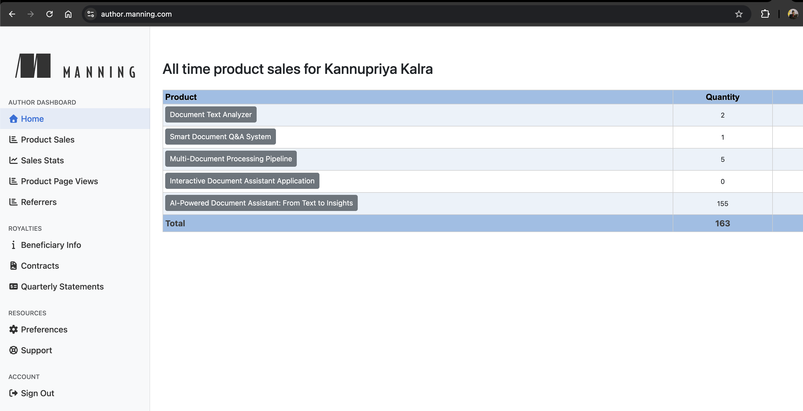
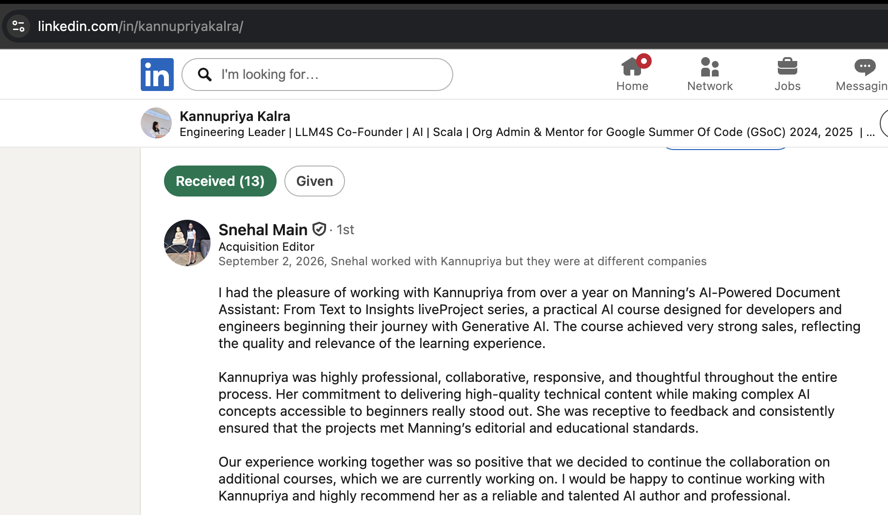

# 👋 Hi, I'm Kannupriya

**Engineering Leader & Scala Developer | AI Author & LLM Engineer | AI Educator & Community Builder | Open Source Mentor**

With over a decade of experience designing scalable backend systems using functional programming, I specialize in building resilient, high-availability platforms with Scala. At Sky, London, I led critical backend development using functional Scala to power large-scale operations.

A passionate contributor to the Scala ecosystem, I co-created **[LLM4S](https://github.com/llm4s/llm4s)**, a Scala-first AI platform, and have actively contributed to projects like **[Scala CLI](https://github.com/VirtusLab/scala-cli)** and **[Scaladex](https://github.com/scalacenter/scaladex)**. I serve as a **Google Summer of Code (GSoC) Org Admin & Mentor (2024, 2025)** with the Scala Center, mentoring contributors and helping grow the next generation of open source developers.
I am a **core maintainer** of [LLM4S](https://github.com/llm4s/llm4s), [Copilot Lens](https://github.com/pavanvamsi3/copilot-lens), [triage4s](https://github.com/pavanvamsi3/triage4s), [typesafe4s](https://github.com/gruggiero/typesafe4s), and the private Reign repositories: [Reign](https://github.com/hummingbatman/reign), [Reign Android](https://github.com/hummingbatman/reign_android), and [Reign Rulebook](https://github.com/hummingbatman/reign_rulebook), listed below. I also maintain **[Scaladex](https://github.com/scalacenter/scaladex)** and support initiatives under **[Google Summer of Code](https://github.com/scalacenter/GoogleSummerOfCode?tab=readme-ov-file)**.

I'm also building a global AI community focused on responsible and accessible AI development. I offer AI training and education for developers and teams – bridging the gap between functional programming and practical AI applications.
I co-created **four hands-on AI courses (Manning liveProjects)** with **Pavan Vamsi**, based on Amit Bahree's **[Generative AI in Action](https://www.manning.com/books/generative-ai-in-action)**. See the AI Author & LLM Engineer section below.

As a seasoned international speaker, I’ve delivered talks in 8+ countries at events such as **Scala Days**, **Google Open Source Conference**, and **Bay Area Scala Conference**, engaging audiences on AI, functional programming, data engineering, and software design.

### AI Author & LLM Engineer

I co-authored four hands-on AI courses with **Pavan Vamsi**, published by **Manning** as the *AI-Powered Document Assistant: From Text to Insights* liveProject series. Based on **[Generative AI in Action](https://www.manning.com/books/generative-ai-in-action)** by **Amit Bahree**, the courses guide developers through building AI-powered document applications:

1. [Document Text Analyzer](https://www.manning.com/liveproject/document-text-analyzer)
2. [Smart Document Q&A System](https://www.manning.com/liveproject/smart-document-qa-system)
3. [Multi-Document Processing Pipeline](https://www.manning.com/liveproject/multi-document-processing-pipeline)
4. [Interactive Document Assistant Application](https://www.manning.com/liveproject/interactive-document-assistant-application)

#### Course Sales

Since launching around **April 2026**, the series and individual courses have recorded **163 product sales** as shown in my Manning author dashboard in **October 2026**: **155 series purchases** and **8 individual-course purchases**.

#### Editorial Recommendation

In a [LinkedIn recommendation](https://www.linkedin.com/in/kannupriyakalra/details/recommendations/) dated **2 September 2026**, **[Snehal Main](https://www.linkedin.com/in/snehal-main-7754aa123/), Acquisition Editor at Manning**, highlighted the series' very strong sales, the quality of the learning experience, and my ability to make complex AI concepts accessible to beginners. She also described our continued collaboration on additional courses.

#### Courses in Development

Following the strong sales of my first AI course series, I secured further contracts to create courses based on **three additional Manning books**. As an **AI Author and LLM Engineer**, I am currently developing multiple courses covering large language models, reasoning models, and multi-agent systems:

- [Build a Large Language Model (From Scratch)](https://www.manning.com/books/build-a-large-language-model-from-scratch) by Sebastian Raschka
- [Build a Reasoning Model (From Scratch)](https://www.manning.com/books/build-a-reasoning-model-from-scratch) by Sebastian Raschka
- [Build a Multi-Agent System (from Scratch)](https://www.manning.com/books/build-a-multi-agent-system-from-scratch) by Val Andrei Fajardo

### Core Maintainer Roles

| Project | About | Repository |
|---|---|---|
| **LLM4S** | Agentic and LLM programming in Scala. | [llm4s/llm4s](https://github.com/llm4s/llm4s) |
| **Copilot Lens** | Local search and browsing for AI coding-assistant conversations. | [pavanvamsi3/copilot-lens](https://github.com/pavanvamsi3/copilot-lens) |
| **triage4s** | Evidence-backed AI issue triage for Scala, powered by LLM4S. | [pavanvamsi3/triage4s](https://github.com/pavanvamsi3/triage4s) |
| **typesafe4s** | A Scala 3 SDK for the TypeSafe System One API. | [gruggiero/typesafe4s](https://github.com/gruggiero/typesafe4s) |
| **Scaladex** | Maintainer. | [scalacenter/scaladex](https://github.com/scalacenter/scaladex) |
| **Google Summer of Code** | Organization Administrator & Mentor (2024, 2025). | [scalacenter/GoogleSummerOfCode](https://github.com/scalacenter/GoogleSummerOfCode) |
| **Reign** (private repository) | An offline, gamified iOS habit tracker built with SwiftUI. | [hummingbatman/reign](https://github.com/hummingbatman/reign) |
| **Reign Android** (private repository) | The native Kotlin and Jetpack Compose Android app, following the same habit-progression rules. | [hummingbatman/reign_android](https://github.com/hummingbatman/reign_android) |
| **Reign Rulebook** (private repository) | Shared reference scenarios and expected results that keep the iOS and Android progression engines consistent. | [hummingbatman/reign_rulebook](https://github.com/hummingbatman/reign_rulebook) |

### Speaking Highlights

I speak about Scala, practical AI systems, functional programming, and open source mentorship. The talks below include events shared on my [LinkedIn profile](https://www.linkedin.com/in/kannupriyakalra/) and in the [LLM4S talk library](https://github.com/llm4s/llm4s#-talks--presentations), with event details and available recordings and slides.

#### Talks and presentations, 2024–2026

| Date | Event | Talk | Location | Speakers | Links |
|---|---|---|---|---|---|
| 25-Jul-2024 | London Scala Talks: July Edition | Anatomy of Scaladex | The Trade Desk, London, UK | Kannupriya Kalra | [Event](https://ti.to/london-scala-talks/scala-talks-july-edition) · [Recording](https://www.youtube.com/watch?v=8qWsSiLb08U&t=363s) · [LinkedIn post](https://www.linkedin.com/posts/kannupriyakalra_scala-gsoc-googlesummerofcode-activity-7221837733181210625-TFWL) |
| 4-6-Oct-2024 | GSoC 2024 Mentor Summit | Guiding First-time OSS Contributors | Sunnyvale, California, USA | Kannupriya Kalra | [Event](https://sites.google.com/view/2024mentorsummit/) |
| 10-Oct-2024 | Art of Scala 2024 | Introduction to Google Summer of code and Scaladex | Warsaw, Poland | Kannupriya Kalra | [Conference programme](https://artofscala.com/?page_id=3263) · [Recording](https://www.youtube.com/watch?v=w37nlYFHDOg) |
| 10-Dec-2024 | Functional World #13 by Scalac | Anatomy of Scaladex | Gdańsk, Poland | Kannupriya Kalra | [Event](https://www.meetup.com/functionalworld/events/304665863/) · [Recording](https://www.youtube.com/live/G_rjI9PDMl8) · [Event announcement](https://scalac.io/blog/scalendar-december-2024/) |
| 25-Feb-2025 | Bay Area Scala | Let's Teach LLMs to Write Great Scala! | San Francisco, USA | Kannupriya Kalra | [Event](https://lu.ma/5fz2y9or) · [Recording](https://www.youtube.com/watch?v=SXybj2P3_DE&t=779s&ab_channel=SalarRahmanian) [Reddit Discussion](https://www.reddit.com/r/scala/comments/1ipr596/scala_meetup_san_francisco_designing_the_library/?share_id=3IdgjEpmpDcwoIFgNOy1d&utm_content=1&utm_medium=android_app&utm_name=androidcss&utm_source=share&utm_term=3) [Mastodon Post](https://social.softinio.com/@softinio/statuses/01JM3MD5H0R4ZS5CHXN37S878E) [Bluesky Post](https://bsky.app/profile/salarrahmanian.bsky.social/post/3li6lh3funk2q) [X/Twitter Post](https://x.com/SalarRahmanian/status/1890575797947388070) [Meetup Event](https://www.meetup.com/scala-bay/events/306178503/?eventOrigin=group_past_events) |
| 20-Apr-2025 | Scala India | Let's Teach LLMs to Write Great Scala! | India | Kannupriya Kalra | [Event](https://www.linkedin.com/posts/activity-7318299169914249216-Sec-?utm_source=share&utm_medium=member_desktop&rcm=ACoAAA8qk7UBmvcZ2O7aAJfMpsdEXBvcKSNiHWM) · [Recording](https://www.youtube.com/watch?v=PiUaVKuV0dM&ab_channel=ScalaIndia) [Reddit Discussion](https://www.reddit.com/r/scala/comments/1k0r1c7/upcoming_scala_india_talk_on_topic_lets_teach/?share_id=aPCwPdh0wOkxuPfsU7f3j&utm_content=1&utm_medium=android_app&utm_name=androidcss&utm_source=share&utm_term=3) [X/Twitter Post](https://x.com/themightysid888/status/1912758284509134866) |
| 28-May-2025 | Functional World 2025 by Scalac | Let's Teach LLMs to Write Great Scala! | Gdansk, Poland | Kannupriya Kalra | [Event](https://www.meetup.com/functionalworld/events/307654612/?eventOrigin=group_upcoming_events) · [Recording](https://www.youtube.com/watch?v=cNAmsIpSsgk&ab_channel=Scalac) [LinkedIn Post 1](https://www.linkedin.com/posts/scalac_ai-functionalworld-scala-ugcPost-7326538223818563584-U2Ru) [LinkedIn Post 2](https://www.linkedin.com/posts/scalac_lets-teach-llms-to-write-great-scala-ugcPost-7332752921190625281-K2YD) [Reddit Discussion](https://www.reddit.com/r/scala/comments/1krvvgv/meetup_lets_teach_llms_to_write_great_scala/) [X/Twitter Post](https://x.com/FunctionalWorld/status/1920776605015674943) [Scalendar (May 2025)](https://www.linkedin.com/pulse/scalendar-may-2025-scalac-qck6e/?trackingId=aSO5CkxeSB2O0U4GPUxJuw%3D%3D) [Scala Times 1](https://scalatimes.com/ead904f5c2) [Scala Times 2](https://scalatimes.com/af935bf2d5) |
| 13-Jun-2025 | Dallas Scala Enthusiasts | Let's Teach LLMs to Write Great Scala! | Dallas, USA | Kannupriya Kalra | [Event](https://www.meetup.com/dallas-scala-enthusiasts/events/307717420/?eventOrigin=find_page%24all) · [Recording](https://www.youtube.com/watch?v=-PnsSSWTye0&ab_channel=DallasScalaEnthusiasts) [LinkedIn Post](https://www.linkedin.com/posts/kannupriyakalra_scala-ai-llm4s-activity-7338339521807212544-t5gT) [X/Twitter Post](https://x.com/KannupriyaKalra/status/1932864594025836700) [Reddit Discussion](https://www.reddit.com/r/scala/comments/1l9iheb/talk_llm4s_talk_in_dallas_scala_meets_ai_june_13/) [Bluesky Post](https://bsky.app/profile/kannupriyakalra.bsky.social/post/3lrfuplb3oc2n) [Mastodon Post](https://functional.cafe/@kannupriyakalra/114672918629990024) [Scalendar (June 2025)](https://www.linkedin.com/pulse/scalendar-june-2025-scalac-fmiwe/?trackingId=ifE4kllzPvQvBqItbqXL4w%3D%3D) |
| 13-Aug-2025 | London Scala Users Group | Scala Meets GenAI: Build the Cool Stuff with LLM4S | [The Trade Desk office](https://www.thetradedesk.com/), London, UK | Kannupriya Kalra, Rory Graves | [Event](https://www.meetup.com/london-scala/events/308564399/?utm_medium=email&utm_campaign=rsvp-confirmation-social) [X/Twitter Post](https://x.com/KannupriyaKalra/status/1949925385992622131) [Bluesky Post](https://bsky.app/profile/kannupriyakalra.bsky.social/post/3lv2g77b2yk2s) [LinkedIn Post](https://www.linkedin.com/posts/kannupriyakalra_scala-genai-llms-activity-7357084500595482626-CxBe?utm_source=share&utm_medium=member_desktop&rcm=ACoAAA8qk7UBmvcZ2O7aAJfMpsdEXBvcKSNiHWM) [Scalendar (August 2025)](https://www.linkedin.com/pulse/scalendar-august-2025-scalac-cxoje/?trackingId=c5MNCnKeSOeff0LojUz0ug%3D%3D) |
| 21-Aug-2025 | Scala Days 2025 | Scala Meets GenAI: Build the Cool Stuff with LLM4S | [EPFL campus](https://www.epfl.ch/en/), Lausanne, Switzerland | Kannupriya Kalra, Rory Graves | [Event](https://scaladays.org/editions/2025/talks/scala-meets-genai-build-the) · [Recording](https://www.youtube.com/watch?v=5od95FbNjiI) [LinkedIn Post](https://www.linkedin.com/feed/update/urn:li:activity:7348123421945262080/) [X/Twitter Post](https://x.com/KannupriyaKalra/status/1942369453267947900) [Reddit Discussion](https://www.reddit.com/r/scala/comments/1lua1ud/talk_llm4s_at_scala_days_2025_scala_meets_genai/) [Bluesky Post](https://bsky.app/profile/kannupriyakalra.bsky.social/post/3ltfyhmlsi22p) [Mastodon Post](https://functional.cafe/@kannupriyakalra/114814671581110365) [Scala Days 2025: August in Lausanne – Code, Community &amp; Innovation](https://scalac.io/blog/scala-days-2025-august-lausanne-code-community-innovation/) [Scalendar (August 2025)](https://www.linkedin.com/pulse/scalendar-august-2025-scalac-cxoje/?trackingId=c5MNCnKeSOeff0LojUz0ug%3D%3D) [Scala Days 2025 LinkedIn Post](https://www.linkedin.com/posts/scalac_scala-scalac-scaladays2025-activity-7359538627879571456-5YKa?utm_source=share&utm_medium=member_desktop&rcm=ACoAAA8qk7UBmvcZ2O7aAJfMpsdEXBvcKSNiHWM) [Scala Days 2025 Highlights](https://www.linkedin.com/posts/scalac_scala-days-2025-highlights-our-key-takeaways-activity-7370816575886483456-3g6w?utm_source=share&utm_medium=member_desktop&rcm=ACoAAA8qk7UBmvcZ2O7aAJfMpsdEXBvcKSNiHWM) [Scala Days 2025 Wrap](https://www.linkedin.com/posts/scalac_scala-days-2025-ugcPost-7364632095945547778-8sAk?utm_source=share&utm_medium=member_desktop&rcm=ACoAAA8qk7UBmvcZ2O7aAJfMpsdEXBvcKSNiHWM) [Scala Days 2025 Recap – A Scala Community Reunion](https://scalac.io/blog/scala-days-2025-recap-a-scala-community-reunion/) [Xebia Scala days blog](https://xebia.com/blog/scala-days-2025-ai-integration/) |
| 25-Aug-2025 | Zürich Scala Enthusiasts | Fork It Till You Make It: Career Building with Scala OSS | Zürich, Switzerland | Kannupriya Kalra | [Event](https://lnkd.in/emMVS8Mj) [LinkedIn Post](https://www.linkedin.com/posts/kannupriyakalra_scala-opensource-llm4s-activity-7354152797799342080-O_ik) [X/Twitter Post](https://x.com/KannupriyaKalra/status/1948388464837226568) [Bluesky Post](https://bsky.app/profile/kannupriyakalra.bsky.social/post/3lupqmo2z722j) [Mastodon Post](https://functional.cafe/@kannupriyakalra/114908674646390403) [Reddit Discussion](https://www.reddit.com/r/scala/comments/1m867vu/zurich_career_growth_through_scala_oss_join_our/) [Scalendar (August 2025)](https://www.linkedin.com/pulse/scalendar-august-2025-scalac-cxoje/?trackingId=c5MNCnKeSOeff0LojUz0ug%3D%3D) |
| 18-Sept-2025 | Scala Center Talks | Lightning Talks Powered by GSoC 2025 for Scala | Lausanne, Switzerland | Kannupriya Kalra | [Event](https://luma.com/3eda0rsz) [LinkedIn Post](https://www.linkedin.com/posts/shubham-vish_ai-generativeai-artificialintelligence-activity-7373039711487070208-WlYm?utm_source=share&utm_medium=member_desktop&rcm=ACoAADmu6soBQhs2fe8_CNIw2ChlNe0Oon4E3G0) [Scala Center's LinkedIn Post](https://www.linkedin.com/posts/davidgilmendez_lightning-talks-powered-by-gsoc-2025-activity-7373294561311391746-9gpG?utm_source=share&utm_medium=member_desktop&rcm=ACoAAA8qk7UBmvcZ2O7aAJfMpsdEXBvcKSNiHWM) [X/Twitter Post](https://x.com/KannupriyaKalra/status/1968408400330416301) [Mastodon Post](https://functional.cafe/@kannupriyakalra/115221495411735909) [Bluesky Post](https://bsky.app/profile/kannupriyakalra.bsky.social/post/3lz2oedo5rs2o) [Reddit Discussion](https://www.reddit.com/r/scala/comments/1nk2t4b/event_today_scala_center_org_google_summer_of/?utm_source=share&utm_medium=web3x&utm_name=web3xcss&utm_term=1&utm_content=share_button) [Slides 1 (PDF)](https://github.com/llm4s/llm4s/blob/main/docs/image_assets/gsoc_assets/gsoc_2025/talks/gsoc_lighting_talks_2025/slides/Anshuman_Awasthi_LLM4S_Support_image_voice_and_other_LLM_modalites.pdf) [Slides 2 (PDF)](https://github.com/llm4s/llm4s/blob/main/docs/image_assets/gsoc_assets/gsoc_2025/talks/gsoc_lighting_talks_2025/slides/Elvan_Konukseven_LLM4S_Implement_an_agentic_toolkit_for_Large_Language_Models.pdf) [Slides 3 (PDF)](https://github.com/llm4s/llm4s/blob/main/docs/image_assets/gsoc_assets/gsoc_2025/talks/gsoc_lighting_talks_2025/slides/Gopi_Trinadh_Maddikunta_LLM4S_RAG_in_a_box.pdf) [Slides 4 (PDF)](https://github.com/llm4s/llm4s/blob/main/docs/image_assets/gsoc_assets/gsoc_2025/talks/gsoc_lighting_talks_2025/slides/Shubham_Vishwakarma_LLM4S_Tracing_support.pdf) [Slides 1 (PPTX)](https://github.com/llm4s/llm4s/blob/main/docs/image_assets/gsoc_assets/gsoc_2025/talks/gsoc_lighting_talks_2025/slides/Anshuman_Awasthi_LLM4S_Support_image_voice_and_other_LLM_modalites.pptx) [Slides 2 (PPTX)](https://github.com/llm4s/llm4s/blob/main/docs/image_assets/gsoc_assets/gsoc_2025/talks/gsoc_lighting_talks_2025/slides/Elvan_Konukseven_LLM4S_Implement_an_agentic_toolkit_for_Large_Language_Models.pptx) [Slides 3 (PPTX)](https://github.com/llm4s/llm4s/blob/main/docs/image_assets/gsoc_assets/gsoc_2025/talks/gsoc_lighting_talks_2025/slides/Gopi_Trinadh_Maddikunta_LLM4S_RAG_in_a_box.pptx) [Slides 4 (PPTX)](https://github.com/llm4s/llm4s/blob/main/docs/image_assets/gsoc_assets/gsoc_2025/talks/gsoc_lighting_talks_2025/slides/Shubham_Vishwakarma_LLM4S_Tracing_support.pptx) |
| 12-18-Oct-2025 | ICFP/SPLASH 2025 (The Scala Workshop 2025) | Mentoring in the Scala Ecosystem: Insights from Google Summer of Code | Singapore | Kannupriya Kalra | [Event](https://conf.researchr.org/home/icfp-splash-2025) · [Recording](https://www.youtube.com/live/OtFPJNFJSsA?si=XIg9LM2OaRBuXR2C&t=26236) [The Scala Workshop 2025 Schedule](https://2025.workshop.scala-lang.org/#program) [LinkedIn Post](https://www.linkedin.com/posts/kannupriyakalra_icfp2025-splash2025-functionalprogramming-activity-7379263313022730240-5uOk?utm_source=share&utm_medium=member_desktop&rcm=ACoAAA8qk7UBmvcZ2O7aAJfMpsdEXBvcKSNiHWM) [X/Twitter Post](https://x.com/KannupriyaKalra/status/1973507011003424968) [Mastodon Post](https://functional.cafe/@kannupriyakalra/115301118970199281) [Bluesky Post](https://bsky.app/profile/kannupriyakalra.bsky.social/post/3m25zmx47nc2u) [Reddit Discussion](https://www.reddit.com/r/scala/comments/1o5g0wn/announcement_paper_presentation_at_icfpsplash/?utm_source=share&utm_medium=web3x&utm_name=web3xcss&utm_term=1&utm_content=share_button) |
| 23-25-Oct-2025 | Google Summer Of Code Mentor Summit 2025 | LLM4S x GSoC 2025: Engineering GenAI Agents in Functional Scala | Munich, Germany | Kannupriya Kalra | [Event](https://sites.google.com/view/2025mentorsummit/home) · [Slides](https://github.com/llm4s/llm4s/blob/main/docs/image_assets/gsoc_assets/gsoc_2025/talks/gsoc_mentor_summit_2025/LLM4S_x_GSoC_2025_Engineering_GenAI_Agents_in_Functional_Scala/LLM4S_x_GSoC_2025_Engineering_GenAI_Agents_in_Functional_Scala_by_Kannupriya_Kalra.pdf) [Download Scala Center Slides](https://github.com/llm4s/llm4s/blob/main/docs/image_assets/gsoc_assets/gsoc_2025/talks/gsoc_mentor_summit_2025/LLM4S_x_GSoC_2025_Engineering_GenAI_Agents_in_Functional_Scala/LLM4S_x_GSoC_2025_Engineering_GenAI_Agents_in_Functional_Scala_by_Kannupriya_Kalra.pptx) [View GSoC Mentor Summit All Speakers Slides](https://github.com/llm4s/llm4s/blob/main/docs/image_assets/gsoc_assets/gsoc_2025/talks/gsoc_mentor_summit_2025/LLM4S_x_GSoC_2025_Engineering_GenAI_Agents_in_Functional_Scala/GSoC_2025_Lightning_Talk_Mentor_Summit_Slides_Germany.pdf) [Download GSoC Mentor Summit All Speakers Slides](https://github.com/llm4s/llm4s/blob/main/docs/image_assets/gsoc_assets/gsoc_2025/talks/gsoc_mentor_summit_2025/LLM4S_x_GSoC_2025_Engineering_GenAI_Agents_in_Functional_Scala/GSoC_2025_Lightning_Talk_Mentor_Summit_Slides_Germany.pptx) |
| 24-Oct-2025 | GEN AI London 2025 | Building Reliable AI systems: From Hype to Practical Toolkits | London, UK | Kannupriya Kalra | [Event](https://www.genailondon.uk/speakers) · [Slides](https://github.com/llm4s/llm4s/blob/main/docs/image_assets/talks/GEN_AI_London_2025/Kannupriya_Kalra_GenAI_London_Building%20Reliable%20AI%20Systems_From_Hype_to_Practical_Toolkits.pdf) [GEN AI London 2025 Schedule](https://www.genailondon.uk/programme) [LinkedIn Post 1](https://www.linkedin.com/posts/genailondon_genailondon-genailondon2025-genailondonspeaker-ugcPost-7385254431333883904-1eZk?utm_source=share&utm_medium=member_desktop&rcm=ACoAADmu6soBQhs2fe8_CNIw2ChlNe0Oon4E3G0) [LinkedIn Post 2](https://www.linkedin.com/posts/kannupriyakalra_genai-genai-ai-activity-7387419483914522624--NfX?utm_source=share&utm_medium=member_desktop&rcm=ACoAADmu6soBQhs2fe8_CNIw2ChlNe0Oon4E3G0) [LinkedIn Post 3](https://www.linkedin.com/posts/kannupriyakalra_genailondon2025-genailondon-activity-7387421709043204096-yUJs?utm_source=share&utm_medium=member_desktop&rcm=ACoAADmu6soBQhs2fe8_CNIw2ChlNe0Oon4E3G0) [X/Twitter Post](https://x.com/KannupriyaKalra/status/1981647405071368231) [Mastodon Post](https://functional.cafe/@kannupriyakalra/115428352731873350) [Bluesky Post](https://bsky.app/profile/kannupriyakalra.bsky.social/post/3m3wjhmkhfs25) [Reddit Discussion](https://www.reddit.com/r/scala/comments/1oexkzw/announcement_my_mentor_is_going_to_talk_at_genai/) [Download Slides](https://github.com/llm4s/llm4s/blob/main/docs/image_assets/talks/GEN_AI_London_2025/Kannupriya_Kalra_GenAI_London_Building%20Reliable%20AI%20Systems_From_Hype_to_Practical_Toolkits.pptx) |
| 29-30-Nov-2025 | Oaisys Conf 2025: AI Practitioners Conference | LLM4S: Building Reliable AI Systems in the JVM Ecosystem | Pune, India | Kannupriya Kalra, Shubham Vishwakarma | [Event](https://theoaisys.com/#registration) · [Slides](https://github.com/llm4s/llm4s/blob/main/docs/image_assets/talks/Oaisys_2025_AI_Practitioners_Conference/LLM4S_Building_Reliable_AI_Systems_in_the_JVM_Ecosystem.pdf) [LinkedIn Post](https://www.linkedin.com/posts/kannupriyakalra_ai-genai-llm-ugcPost-7400455606865911808-JWd7?utm_source=share) [X/Twitter Post](https://x.com/KannupriyaKalra/status/1994683063054500035?s=20) [Mastodon Post](https://functional.cafe/@kannupriyakalra/115631876757606748) [Bluesky Post](https://bsky.app/profile/kannupriyakalra.bsky.social/post/3m6qx6fkwcs2y) [Reddit Post](https://www.reddit.com/r/scala/comments/1p9ovvk/upcoming_talk_llm4s_reliable_genai_for_the_jvm/) [Download Slides](https://github.com/llm4s/llm4s/blob/main/docs/image_assets/talks/Oaisys_2025_AI_Practitioners_Conference/LLM4S_Building_Reliable_AI_Systems_in_the_JVM_Ecosystem.pptx) |
| 10-Dec-2025 | AI Compute & Hardware Conference 2025 | Functional Intelligence: Building Scalable AI Systems for the Hardware Era | San Jose, USA | Kannupriya Kalra | [Event](https://luma.com/ql64e6yo?tk=RWbeu7) [Event details on Meetup](https://www.meetup.com/bay-area-computer-vision-and-deep-learning-meet-up/events/312286702/?eventOrigin=group_upcoming_events) [LinkedIn Post](https://www.linkedin.com/posts/kannupriyakalra_scala-genai-llm4s-activity-7403208643388903424-nV1c) [X/Twitter Post](https://x.com/KannupriyaKalra/status/1997431694006333475?s=20) [Mastodon Post](https://functional.cafe/@kannupriyakalra/115674987787442544) [Bluesky Post](https://bsky.app/profile/kannupriyakalra.bsky.social/post/3m7dzzdii222w) [Reddit Post](https://www.reddit.com/r/scala/comments/1pg5fn0/talk_at_samsung_semiconductor_san_jose_functional/?utm_source=share&utm_medium=web3x&utm_name=web3xcss&utm_term=1&utm_content=share_button) |
| 16-Sep-2026 | Microsoft Global Hackathon 2026 | Build with LLMs: Open Source AI for the JVM | Mountain View, USA | Kannupriya Kalra | [Event](https://techcommunity.microsoft.com/blog/mvp-blog/microsoft-global-hackathon-2026-where-mvp-and-rd-community-expertise-meets-innov/4542420) · [Slides](https://github.com/llm4s/llm4s/blob/main/docs/image_assets/talks/Microsoft_Global_Hackathon_2026/Build_with_LLMs_Open_Source_AI_for_the_JVM_Kannupriya_Kalra.pdf) [LinkedIn Post](https://www.linkedin.com/feed/update/urn:li:activity:7505713170179784705/) [X/Twitter Post](https://x.com/llm4sfoundation/status/2099956953363653058?s=20) [Bluesky Post](https://bsky.app/profile/llm4s-foundation.bsky.social/post/3mvlhgkfs3s25) [Mastodon Post](https://mastodon.social/@llm4s_foundation/117276944163595609) [Download Slides](https://github.com/llm4s/llm4s/blob/main/docs/image_assets/talks/Microsoft_Global_Hackathon_2026/Build_with_LLMs_Open_Source_AI_for_the_JVM_Kannupriya_Kalra.pptx) |

#### Upcoming

| Date | Event | Talk | Location | Speakers | Links |
|---|---|---|---|---|---|
| 25-Oct-2026 | DataverseHub | LLM4S Foundation: A Retrospective | [Apple India, Waverock, Hyderabad, India 🇮🇳](https://maps.apple.com/place?_provider=9902&address=Apple+India+Private+Limited%2C+Waverock+Building%2C+Tower+2.2%2C+TSIIC+Limited%2C+No.+115%2C+Nanakramguda+Serilingampally+Mandal+Gachibowli%2C+Hyderabad%2C+500008%2C+Telangana%2C+India&coordinate=17.418562%2C78.346864&map=explore&name=Hyderabad+2&place-id=IA10DFA47139804AF) | Kannupriya Kalra | [Event](https://dataversehub.in/events/llm4s-foundation-a-retrospective) |
| 27-Nov-2026 | LLMday + Prompt Engineering Conference London Q4 2026 | LLM4S 1.0: From Idea to Production AI in Scala/JVM | London, UK | Kannupriya Kalra, Rory Graves | [Event](https://llmday.com/2026-london-q4/Kannupriya_Kalra__Rory_Graves_LLM4S_Foundation__The_Trade_Desk_LLM4S_10_From_Idea_to_Production_AI_i) |

My wider speaking experience also includes Art of Scala, ScalaIO, London Scala User Group, Scalabridge, and Google Summer of Code Mentor Summits.

I'm committed to **mentoring developers**, **building inclusive communities**, and advancing the global adoption of **Scala**, **open source**, and **ethical AI**.

  

**Cheers to showing up every day, even when it's hard and becoming a little better each time.** ✨
This photo from my first day at the Sky Sports Studio in 2022 serves as a reminder for me, progress isn’t always loud, but it’s always worth it. 💻🎾
Grateful for the journey so far, and trust in the universe for the path forward it's creating for me. 💫
